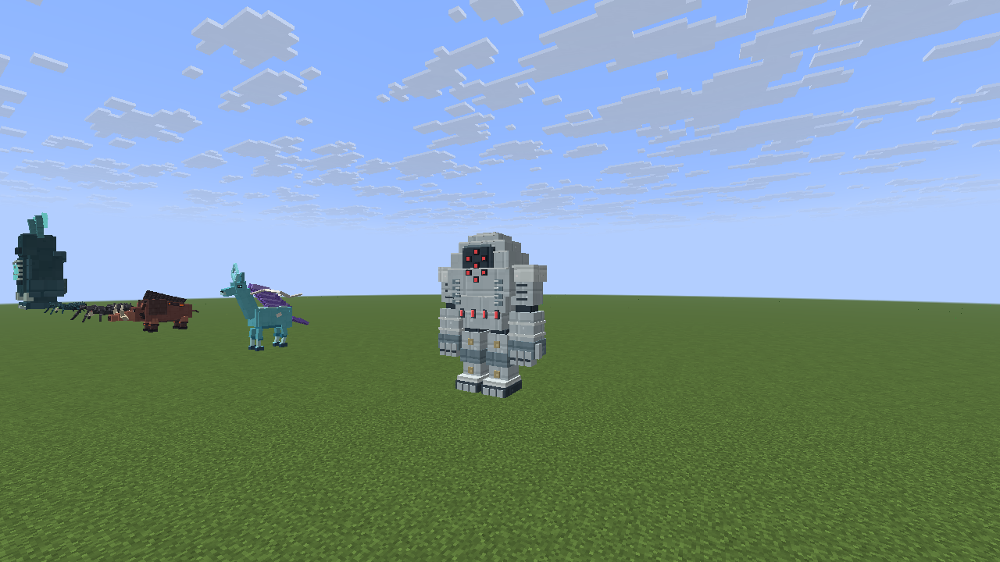
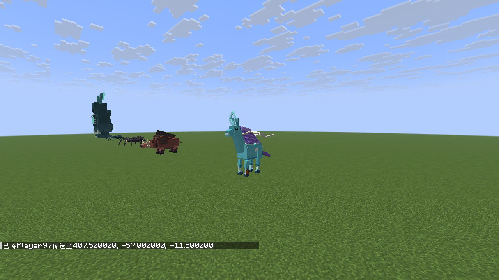
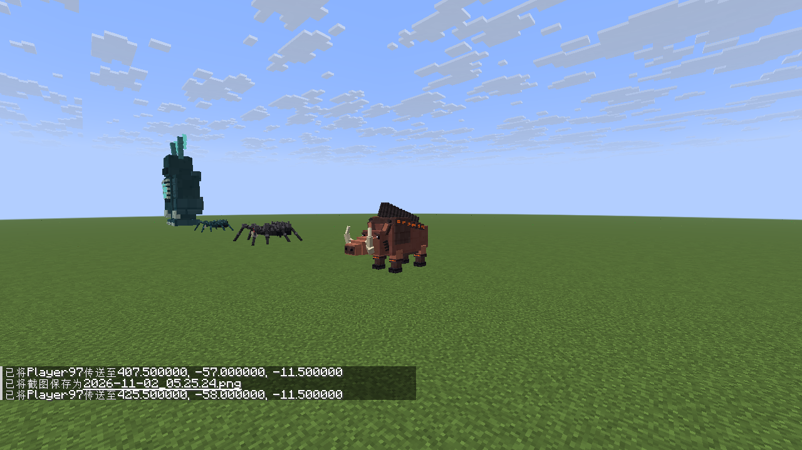
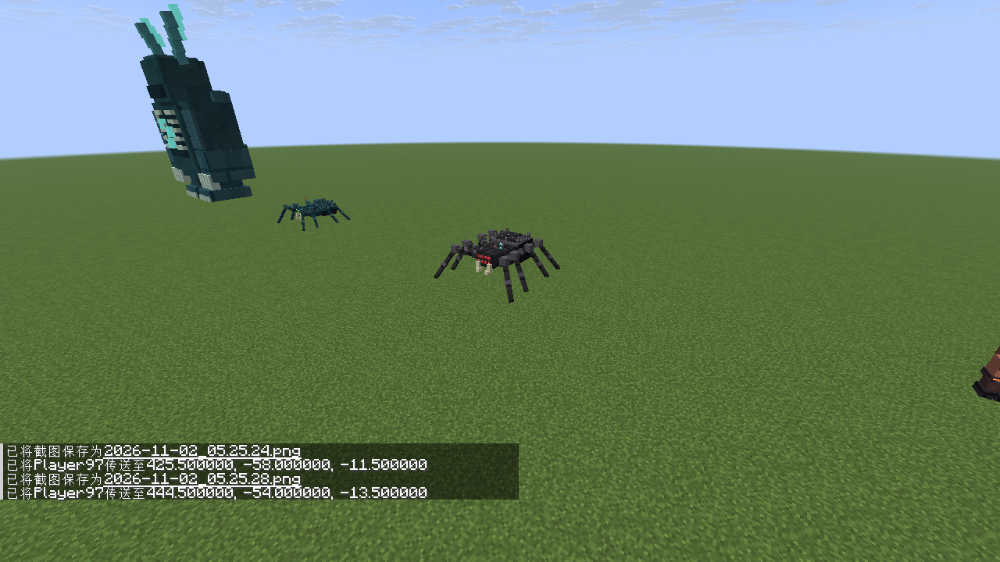
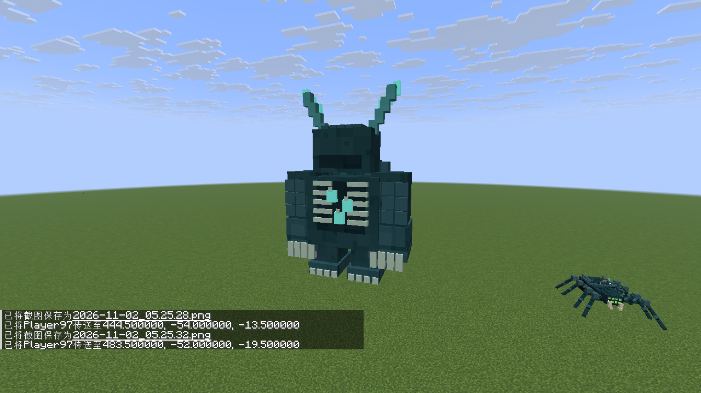

# 下载 v0.3.0

<table><tr><td><strong>万物皆 Boss v0.3.0</strong> Java 1.21.10 · Fabric JAR · 27.4 MB</td><td></td></tr></table>

[备用 JAR 直链](https://raw.githubusercontent.com/susu2020oxo/boos/refs/heads/downloads-v0.3.0/worldbosses-0.3.0-fabric-1.21.10.jar) · [源码 ZIP](https://github.com/susu2020oxo/boos/raw/refs/heads/downloads-v0.3.0/worldbosses-0.3.0-source.zip)

ZIP 包含对应 Fabric API。Java 21，将两个 JAR 放入 Minecraft 1.21.10 Fabric 实例的 mods 文件夹。更新时移出旧版 World Bosses JAR。

## 这一版改了什么

- 监守者相对 0.2 版放大 **5 倍**，碰撞核心高度约 **12.42 格**。
- 铁傀儡重做为约 **6.7 格高**的钢铁守卫：七点红光面甲、分段钢躯、巨臂重靴。
- 马重做为青蓝马身、修长四肢、紫色流鬃、白色飘带与菱形冠。
- 赤脊獠王改成长吻、高肩、外翻獠牙与赤热硬鬃的野猪。
- 蜘蛛和洞穴蜘蛛的八条腿从身体两侧分开连接，向前后展开，步态同步调整。
- 苦力怕和裂核弹强度 **200**（TNT 强度 4 的 50 倍），能破坏方块。爆炸会影响范围内的使用者，可能造成明显卡顿及大面积地形损毁。
- 掉落物免材料、免弹药、免耐久、无技能冷却；增益食物可重复食用。加工工具正常转换原料，弓弩保留拉弓/装填动作。
- 武器攻击与技能威力提高，工具范围扩大。护甲头/胸/腿/脚为 **8/16/12/8**，每件韧性 +5、抗击退 +15%；整套额外生命 +22，靴子移速 +15%，头盔攻击 +3。原版总护甲上限 30、韧性上限 20 仍适用。

保留 68 种独立生物模型、68 件专属掉落物、立体刷怪蛋与原有生成限制。友好动物保持容易击败，猪仍额外掉落 72–96 个原版猪排。

已通过构建、6 项生成预算测试、5 项资源测试、**19 项模组 GameTest**，以及实际发行 JAR 客户端检查。检查记录见 [validation.json](worldbosses-0.3.0-validation.json)，文件校验见 [SHA256SUMS.txt](SHA256SUMS.txt)。

敌对技能仍有共享招式框架；长期多人平衡、所有动画状态尚未穷尽测试。

## 游戏实拍

### 钢铁守卫

### 流鬃灵马

### 赤脊獠王

### 八足蜘蛛

### 五倍监守者

