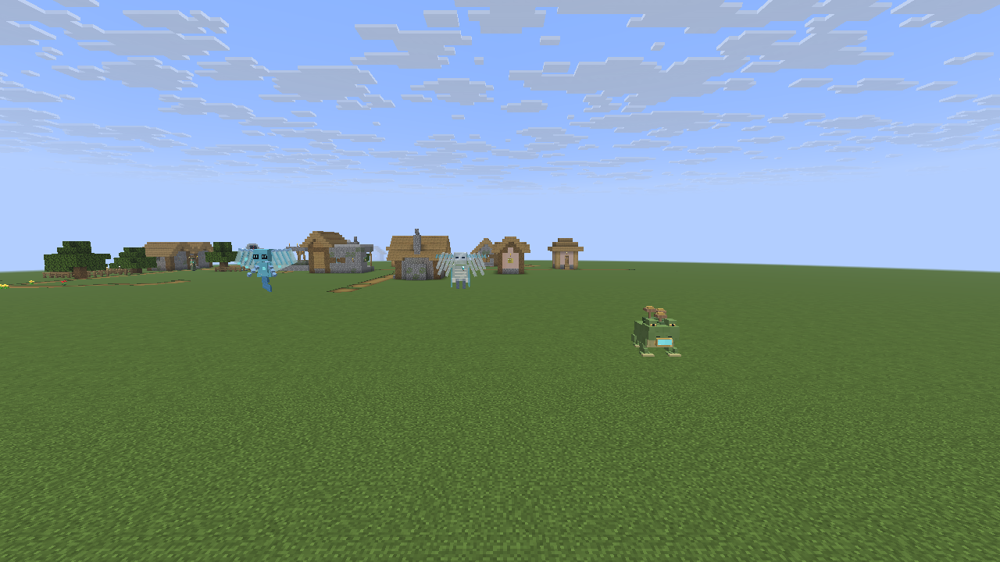
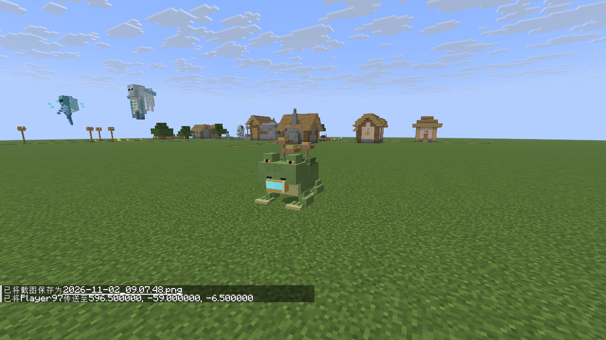
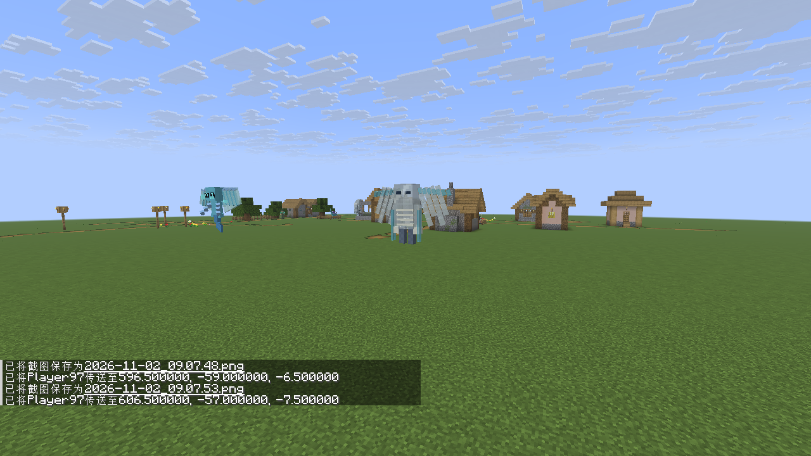
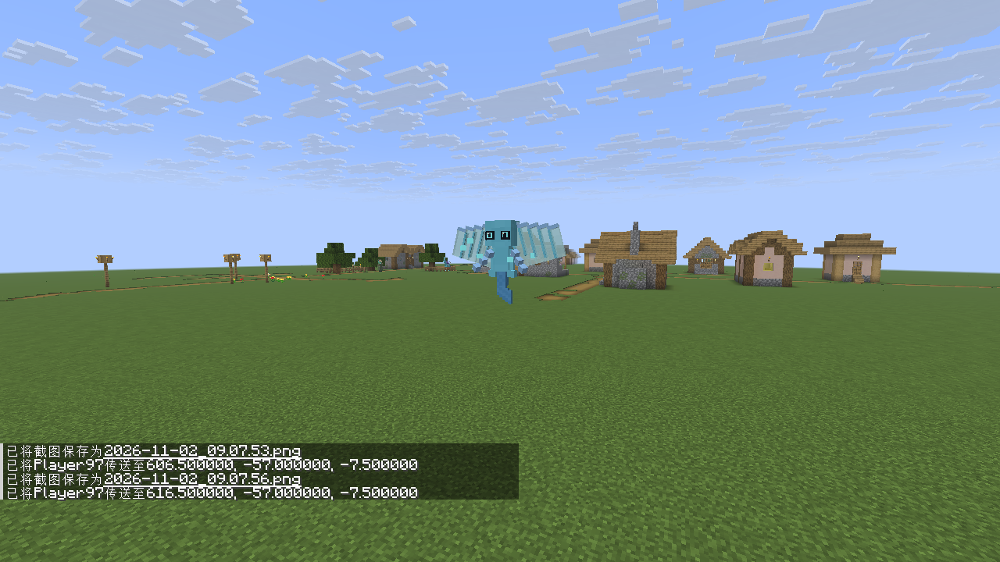

# 下载 v0.3.1

<table><tr><td><strong>万物皆 Boss v0.3.1</strong> Java 1.21.10 · Fabric JAR · 27.4 MB</td><td></td></tr></table>

[备用 JAR 直链](https://raw.githubusercontent.com/susu2020oxo/boos/refs/heads/downloads-v0.3.1/worldbosses-0.3.1-fabric-1.21.10.jar) · [源码 ZIP](https://github.com/susu2020oxo/boos/raw/refs/heads/downloads-v0.3.1/worldbosses-0.3.1-source.zip)

## 本次修复

- 修复 **沼冠蟾王（青蛙）** 和 **裂帛怨灵（恼鬼）** 的模型不可见。
- 同时修复具有相同原因的 **悦灵**。
- 将新模型挂到原版实际使用的内层渲染节点，并修正节点高度与动画绑定。
- 保留 0.3.0 的五倍监守者、新造型、强化掉落物、免使用消耗和生成机制。

已通过 4 种模型的客户端顶点输出、离地高度及头部动画检查，20 项模组 GameTest，构建及资源检查；另用实际发行 JAR 进入游戏确认这三种模型可见。检查记录见 [validation.json](worldbosses-0.3.1-validation.json)。

更新：移出旧版 World Bosses JAR，放入新版后重启游戏，无需重新开档。ZIP 已包含对应 Fabric API；Minecraft Java 1.21.10、Fabric Loader 0.17.3 或更新版本、Java 21。客户端和服务器均使用对应版本。

## 修复后游戏实拍

### 沼冠蟾王

### 裂帛怨灵

### 悦灵

文件校验：[SHA256SUMS.txt](SHA256SUMS.txt)。
